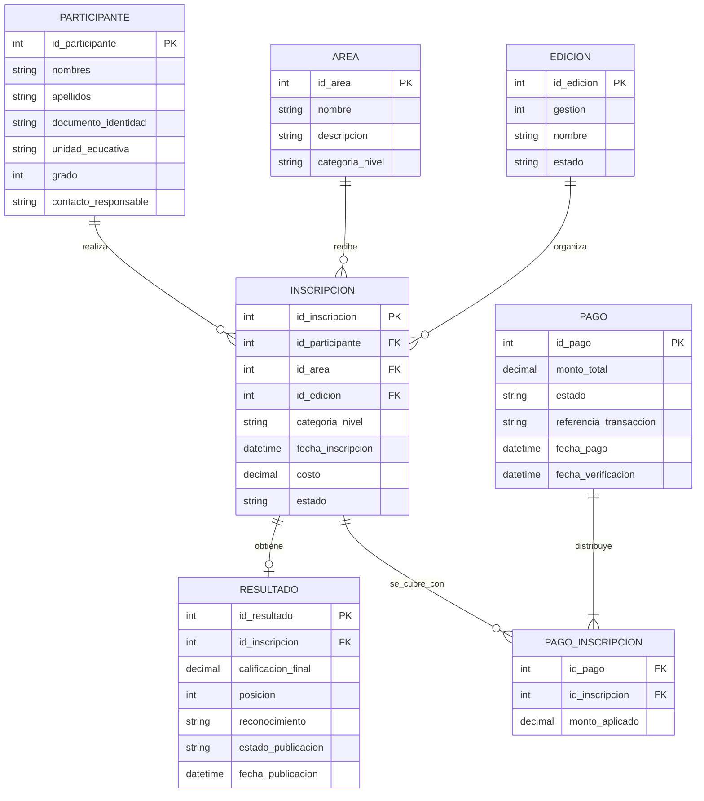

# Modelo de datos — ChuspaOlimpiada

## Alcance

Este documento propone un modelo entidad-relación conceptual para registrar participantes, áreas de competencia, inscripciones, pagos y resultados de distintas ediciones de la Olimpiada FNI. Es una **propuesta de diseño**, no el esquema de una base de datos ya implementada. Los identificadores y tipos son orientativos y deberán validarse durante la implementación.

Se consideran las inscripciones individuales y por delegación descritas en [inscripciones.md](inscripciones.md), así como los pagos y la publicación de resultados. Las reglas de competencia y las condiciones disciplinarias de [datos.md](datos.md) se aplican al proceso, aunque no requieren entidades específicas dentro de este modelo básico.

## Diagrama entidad-relación

`PK` indica clave primaria y `FK` clave foránea. En `PAGO_INSCRIPCION`, la pareja (`id_pago`, `id_inscripcion`) forma una clave primaria compuesta; ambas columnas también son foráneas.

## Entidades y campos principales

| Entidad | Función | Campos principales |
| --- | --- | --- |
| **PARTICIPANTE** | Identifica al estudiante y su contexto educativo. | `id_participante`, `nombres`, `apellidos`, `documento_identidad`, `unidad_educativa`, `grado`, `contacto_responsable` |
| **AREA** | Catálogo de áreas de competencia. | `id_area`, `nombre`, `descripcion`, `categoria_nivel` |
| **EDICION** | Diferencia las gestiones o convocatorias. | `id_edicion`, `gestion`, `nombre`, `estado` |
| **INSCRIPCION** | Vincula un participante con un área y una edición. | `id_inscripcion`, `id_participante`, `id_area`, `id_edicion`, `categoria_nivel`, `fecha_inscripcion`, `costo`, `estado` |
| **PAGO** | Registra un pago y su verificación. | `id_pago`, `monto_total`, `estado`, `referencia_transaccion`, `fecha_pago`, `fecha_verificacion` |
| **PAGO_INSCRIPCION** | Distribuye pagos individuales o agrupados entre inscripciones. | `id_pago`, `id_inscripcion`, `monto_aplicado` |
| **RESULTADO** | Almacena el resultado final correspondiente a una inscripción. | `id_resultado`, `id_inscripcion`, `calificacion_final`, `posicion`, `reconocimiento`, `estado_publicacion`, `fecha_publicacion` |

## Relaciones y cardinalidades

- **PARTICIPANTE 1:N INSCRIPCION:** cada inscripción pertenece a un único participante; un participante puede inscribirse en distintas áreas o ediciones.
- **AREA 1:N INSCRIPCION:** cada inscripción corresponde a una sola área; un área admite muchas inscripciones.
- **EDICION 1:N INSCRIPCION:** cada inscripción pertenece a una edición; una edición agrupa múltiples inscripciones.
- **INSCRIPCION 1:0..1 RESULTADO:** una inscripción puede no tener resultado hasta que se evalúe; el resultado pertenece a una sola inscripción. `RESULTADO.id_inscripcion` debe ser único.
- **PAGO N:M INSCRIPCION:** `PAGO_INSCRIPCION` relaciona pagos con inscripciones y registra el importe aplicado a cada una. Permite pagar varias inscripciones juntas, por ejemplo en una delegación, sin duplicar el pago.

## Reglas de integridad y validación

1. **Sin duplicados:** aplicar una restricción única sobre (`id_participante`, `id_area`, `id_edicion`) en `INSCRIPCION` para impedir múltiples registros de la misma combinación.
2. **Máximo de tres áreas:** comprobar que el participante tenga como máximo tres áreas distintas por edición, siguiendo [inscripciones.md](inscripciones.md); esta regla requiere validación transaccional, no solo una clave única.
3. **Grado y categoría:** validar que el grado del participante sea compatible con el área y la categoría o nivel seleccionados. Los criterios varían por área y convocatoria; consultar [areas-competencia.md](areas-competencia.md).
4. **Costo:** la referencia de la convocatoria 2026 es Bs 20 por estudiante y área. Guardar el costo aplicado en la inscripción permite conservar su valor histórico si cambia una convocatoria. El total de un pago debe conciliarse con las asignaciones correspondientes.
5. **Pagos:** el estado puede ser `pendiente` o `confirmado`; solamente una verificación autorizada permite confirmar un pago. `referencia_transaccion` debe ser única cuando exista para evitar reutilización. Un comprobante o QR mostrado no equivale a verificación.
6. **Resultados:** registrar el resultado únicamente para inscripciones válidas. Su publicación requiere revisión y autorización; los campos de posición y reconocimiento pueden quedar vacíos hasta su determinación.
7. **Protección de datos:** controlar el acceso a identificaciones y contactos; publicar solo los datos necesarios. Los cambios en calificaciones deben auditarse mediante un mecanismo adicional aún por diseñar.
8. **Inscripción por delegación:** se representa mediante inscripciones de cada estudiante y un pago agrupado. La entidad específica para delegaciones, tutores y responsables, así como los pagos parciales y reembolsos, se definirá si los requerimientos funcionales los exigen.

## Coherencia con la documentación

- [datos.md](datos.md): contiene normas de comportamiento, disciplina y seguridad durante las pruebas; el presente diseño no altera esas normas.
- [inscripciones.md](inscripciones.md): se reflejan participante, edición, áreas, límite de tres áreas, registro individual o por delegación, costo y validación de pagos. Los flujos digitales que allí se identifican como propuestas siguen pendientes de aprobación institucional.
- [pagos-y-comprobantes.md](pagos-y-comprobantes.md): el modelo recoge estados, montos y referencias para la verificación de pagos, sin afirmar que una integración bancaria esté implementada.
- [resultados-y-certificacion.md](resultados-y-certificacion.md): se consideran calificación, posición, reconocimiento y publicación. Certificados, reclamos y planillas de ingreso directo quedan fuera de este modelo básico.

**Nota:** este diagrama es conceptual. Antes de convertirlo en tablas físicas deben definirse identificadores oficiales, manejo de tutores y delegaciones, categorías por edición, auditoría y reglas definitivas de pagos y resultados.
